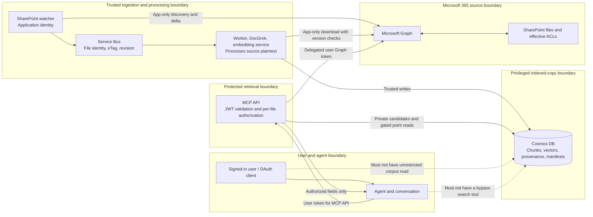
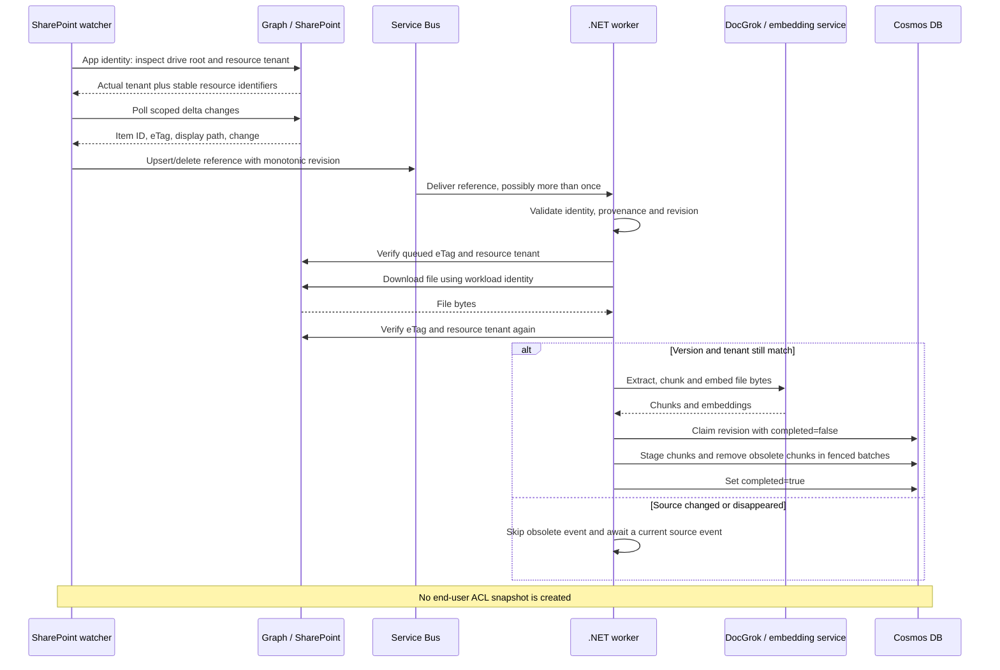
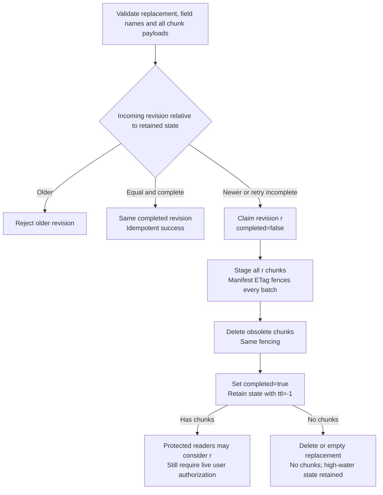
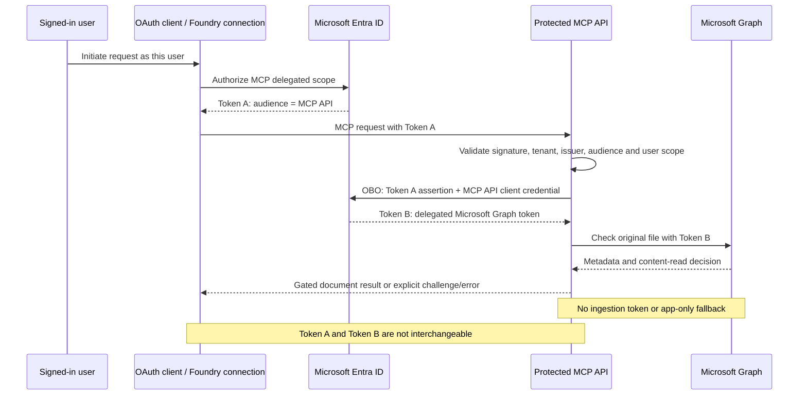
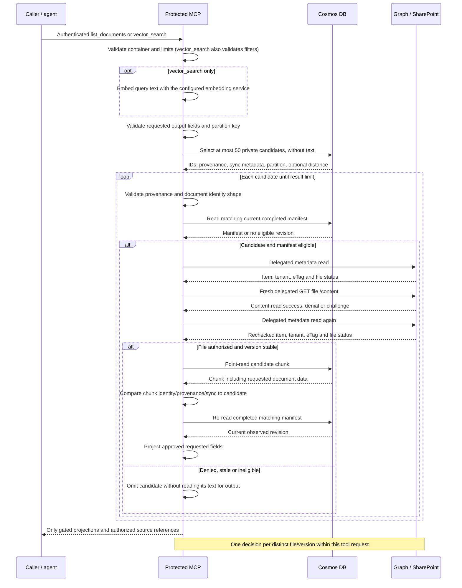
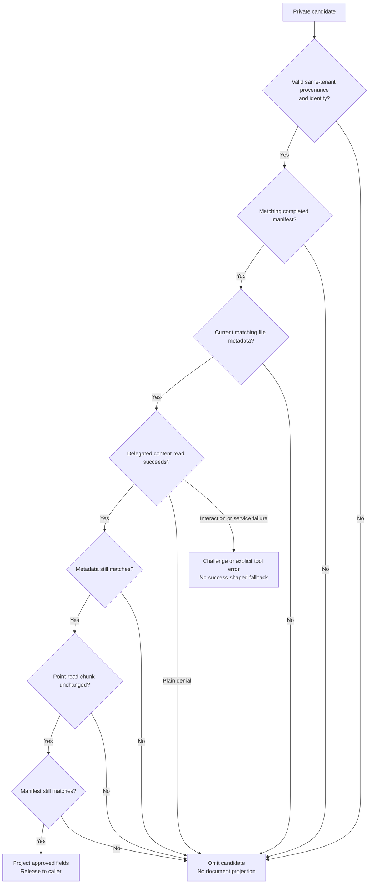
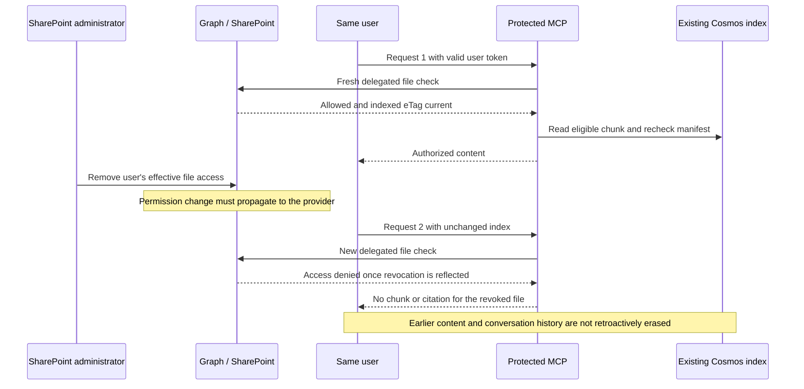

# SharePoint document permissions: end-to-end enforcement in OmniVec

| Document field | Value |
| --- | --- |
| Purpose | Security-team review of SharePoint document ingestion, indexed copies in Cosmos DB, and permission-aware MCP retrieval by an agent |
| Scope | SharePoint Online documents only; not a general OmniVec or portal-role security review |
| Source baseline | Permission-aware retrieval implementation introduced in revision `330e30089e74b447a33b33597f7da839c895536f`, including the accompanying R2 client allowlist in `mcp_servers/cosmos/mcp_auth.py`, R1 generic list/vector query provenance filter in `mcp_servers/cosmos/cosmos_tools.py`, and regression tests in `tests/unit/test_sharepoint_mcp.py` / `tests/unit/test_cosmos_mcp.py` |
| Status | Implementation description and deployment requirements, **not production security approval** |
| Live evidence | The SharePoint watcher, protected MCP/OBO endpoint, and per-user Foundry connection have **not been configured and verified end to end** in the deployment discussed with this implementation |
| Related guides | [SharePoint ingestion and migration](../sharepoint-source.md), [protected MCP deployment](../../mcp_servers/cosmos/README.md#protected-sharepoint-deployment), [platform threat model](threat-model.md) |

## 1. The security model in one page

**SharePoint remains the authority for document access. OmniVec does not copy
SharePoint ACLs, user lists, or group memberships into Cosmos DB.** Instead, each
indexed chunk carries the identity and version of its original SharePoint file.
At retrieval time, the protected MCP server checks that file through Microsoft
Graph **as the signed-in user**, using OAuth on-behalf-of (OBO). It releases a
chunk only after the file-access and index-consistency checks succeed.

This separates two very different permissions:

1. **Permission to index:** the trusted ingestion workload can read the configured
   SharePoint corpus and produce text, embeddings, and other processing copies.
2. **Permission to disclose:** a particular user must independently be able to
   read the original file through delegated Graph access when the protected MCP
   tool is called. The ingestion workload's access is not reused for this check.

Cosmos stores a **privileged copy** of the corpus. Its service-level RBAC does not
reproduce SharePoint ACLs or filter rows for the signed-in user. The MCP
application is the enforcement point between that copy and the user/agent.
Consequently, this model depends on preventing bypass access to the same copies.

The intended disclosure condition is:

> For every chunk released through the protected MCP document tools, the caller
> has a validated, same-tenant delegated identity; its trusted provenance refers
> to a SharePoint file for which a fresh delegated content-read check succeeded;
> the observed SharePoint eTag matches the indexed eTag; and the chunk still
> belongs to the observed completed Cosmos revision.

This is a **point-in-time, application-enforced condition**, not a distributed
transaction or a cryptographic proof of the chunk's contents. It assumes trusted
writers, appropriate Cosmos consistency, complete entrypoint isolation, and the
supported SharePoint policy scope described below. It cannot undo a previous
disclosure or guarantee zero-delay permission revocation.

### 1.1 What flows, and what does not

| Item | Where it flows | Security meaning |
| --- | --- | --- |
| SharePoint permissions and effective group/sharing access | Remain in SharePoint; Graph evaluates access on each new authorization sequence | Source of truth; OmniVec does not implement its own ACL evaluator |
| Site, drive, item, resource tenant, and indexed eTag | Watcher -> queue -> worker -> Cosmos provenance -> private MCP checks | Identifies exactly which source file/version must be authorized |
| Extracted text and embeddings | Worker/DocGrok/embedding service -> Cosmos | Sensitive derived copies; not safe for every user merely because ingestion succeeded |
| User's MCP access token | OAuth client -> protected MCP; used as an OBO assertion with Entra | Establishes the delegated caller; not stored in chunk metadata |
| Delegated Graph access token | Entra -> MCP -> Graph | Authorizes source-file checks as that user; not returned to the agent |
| Approved chunk fields and source references | Protected MCP -> caller/agent after all gates | The only document data the protected tool intentionally releases |
| ACL snapshots, user/group allowlists, ingestion tokens, Graph download URLs | **Not written as SharePoint chunk authorization metadata** | None is a substitute for the live delegated check |

For example, suppose `User-A` can read a policy file and `User-B` cannot. Both may
be allowed to call the MCP API and use the same agent. Only `User-A` may receive
that file's chunks. A portal role, possession of a Function key, successful
Cosmos search, or an agent instruction such as "respect permissions" does not
establish `User-B`'s SharePoint access.

### 1.2 Reading guide

- [Trust boundaries and identities](#2-trust-boundaries-and-identities)
- [Ingestion and provenance](#3-ingestion-what-happens-before-a-user-asks-a-question)
- [Cosmos records and revision controls](#4-what-cosmos-stores-and-what-it-does-not-enforce)
- [User authentication and OBO](#5-user-authentication-and-the-obo-token-exchange)
- [Exact retrieval gates](#6-query-time-authorization-from-candidates-to-agent-visible-content)
- [Revocation, edits, deletion, and races](#7-permission-changes-edits-deletion-and-time-of-check-limits)
- [Failures and entrypoints](#8-failure-behavior-and-entrypoint-coverage)
- [Deployment requirements and limitations](#9-required-deployment-and-isolation-controls)
- [Verification and security sign-off](#12-verification-plan-and-evidence-status)
- [Source evidence and official references](#14-code-evidence-index)

## 2. Trust boundaries and identities

### 2.1 Logical data-flow diagram

Solid arrows show intended flows. Dashed arrows mark access that deployment
controls must prevent for ordinary users and agents. "Trusted" means trusted to
handle the entire indexed corpus, **not** inherently trusted file contents.



The retrieval gate protects disclosure to the caller/agent. It does not prevent
the worker, extraction service, embedding provider, Cosmos administrators, or
other deliberately privileged operators from handling corpus data. Those
principals are inside, or explicitly trusted by, the processing boundary.

### 2.2 Identity and permission matrix

| Principal | Used for | Required access or credential | Does it prove the user's document access? |
| --- | --- | --- | --- |
| Human user | Calling the protected MCP API and reading a source file | Delegated `access_as_user` token for the MCP API; effective access to the file in SharePoint | Identity is necessary; the subsequent Graph file checks establish the observed source access |
| OAuth client, including a Foundry per-user connection | Obtaining the user's MCP token | Pre-registered client, consent to the MCP scope, correct redirect configuration | No; client consent alone is not file permission |
| MCP API app registration | Validating its audience and performing OBO | Single-tenant API registration, v2 tokens, exposed scope, client credential, delegated Graph permission/consent | The app credential alone does not; OBO must include the user's assertion |
| Delegated Graph identity | File metadata and content-read checks | Graph token obtained by OBO for the current caller | Graph evaluates the combination of app delegated permissions and user access |
| SharePoint ingestion workload | Watching and downloading the corpus | Recommended Graph application `Sites.Selected` plus explicit read grants on the selected sites; broader application `Files.Read.All` is an alternative | **No**; intentionally independent of the querying user |
| Worker Cosmos identity | Creating/replacing chunks and manifests | Destination data-plane write permissions | **No**; it is a trusted publisher of authorization-relevant metadata |
| MCP Function managed identity | Reading Cosmos and generating query embeddings | Cosmos DB Built-in Data Reader on intended containers; Cognitive Services OpenAI User on the configured embedding account | **No**; Cosmos access is application/service access, not user SharePoint access |
| Foundry project or agent identity | Project operations or other configured tools | Project/agent permissions appropriate to that operation | **No**; it must not replace the user's OAuth identity for protected MCP retrieval |

The Python Cosmos client and .NET writer use `DefaultAzureCredential`.
Managed/workload identity is the intended deployed credential. Operators must
control the actual resolved identity and prevent unintended development or
environment credentials from expanding access.

### 2.3 Source permissions are not deployment permissions

Graph delegated access requires both a suitable application permission grant
and the user's access to the resource. Granting the MCP API delegated
`Files.Read.All` does not make all SharePoint files readable by every user.
Likewise, successful API authentication does not prove file access.

For ingestion, `Sites.Selected` application consent alone is insufficient:
the workload also needs a specific grant on the selected resource. Scope
ingestion to the intended sites and register only the approved libraries/folders.
This is corpus-selection and least-privilege control, not user-level trimming.

The code does not enumerate SharePoint permission lists, expand group membership,
or interpret sharing links into a local ACL. It asks Graph whether the current
delegated identity can read the identified file. The implications for special
policies and sharing scenarios are in [section 10](#10-supported-scope-and-explicit-limitations).

## 3. Ingestion: what happens before a user asks a question

### 3.1 Ingestion sequence



The diagram shows an upsert. A delete or intentional empty replacement follows
the same revision-fencing mechanism but ends with no chunks and a retained
completed state record.

### 3.2 Watcher: establish resource identity, not just a path

The watcher uses a fixed Microsoft Graph endpoint to inspect the configured
site/drive root. It obtains the **actual resource tenant** from
`sharepointIds.tenantId`, rather than assuming that a configured application
tenant necessarily owns the file. An explicitly configured pipeline tenant
must match. The tenant is pinned in the source checkpoint; a change requires a
new source rather than silently reassigning existing provenance.

Delta processing produces an envelope containing the source and pipeline,
destination information, upsert/delete operation, stable site/drive/item IDs,
resource tenant, source eTag, and a positive monotonic revision. The SharePoint
reference also includes operational fields such as filename and size limit.
Cross-tenant ingestion may include the tenant/client IDs needed for the
pipeline's workload identity.

The SharePoint-specific envelope does not carry the user's token, an ACL list,
or a preauthenticated download URL. This is not a claim that arbitrary
destination configuration is nonsensitive: queue access must still be restricted
because envelopes contain routing/configuration data and source identifiers.

`source_ref` is a relative display path. It is useful for filtering and citation
display, but a rename can change it. **It is not the stable file identity, an
authorization URL, or evidence that the caller may read the file.**

The watcher uses durable page outboxes and deterministic event IDs so that
partial sends can be replayed. Cursor advancement follows successful sends.
Delivery is at least once; duplicate delivery is expected, not proof of a new
revision. Expired delta cursors require reconciliation, including tombstones
for files no longer present. Revision history must survive rescans.

### 3.3 Worker: bind the indexed bytes to the queued version

The worker validates the SharePoint reference before processing. In particular,
resource tenant, site, drive, item, and upsert eTag are required provenance, and
the revision must be positive. A legacy or malformed reference must not be
treated as an ordinary unprotected text document in this path.

For an upsert the worker:

1. Checks source metadata against the queued eTag and verified resource tenant.
2. Downloads the source file using the ingestion workload identity.
3. Checks the eTag and resource tenant again.
4. Sends the accepted bytes for extraction, chunking, and embedding.
5. Attaches the same source identity/version and revision to all output chunks.

These checks reduce the risk of indexing one version under another version's
provenance. They are not an atomic SharePoint lock. A version-change or
disappearance result skips the obsolete event; it does not authorize returning
the old indexed text. Retrieval independently checks the live file version.
Other failures follow the worker's error/retry handling.

The download is buffered in memory and bounded to a maximum raw size of 50 MiB.
During ingestion the HTTP client follows the normal file-download redirect
because it actually needs the bytes. This is different from the retrieval-time
permission probe, which deliberately does **not** follow the redirect.

### 3.4 All ingestion processors are inside the data-handling scope

ACL enforcement at retrieval does not remove plaintext exposure during
ingestion. The worker, DocGrok/extraction components, configured embedding
providers, their operational telemetry, and the Cosmos destination must be
approved to process the source corpus. A provider that receives a chunk for
embedding already has that chunk before any end-user MCP request.

The security review must therefore include the selected providers, data
classification, retention, regional boundaries, and privileged operator access.
Those are prerequisites to indexing; they are not solved by per-user filtering
at the end of the pipeline.

## 4. What Cosmos stores, and what it does not enforce

### 4.1 Stable identity and dedicated partition

For one source file in one source/pipeline scope, the writer derives:

```text
identity = "sp-" + lowercase_hex(
    SHA256(UTF8(JSON([source_id, site_id, drive_id, item_id, pipeline_id])))
)

chunk ID = identity + "-" + revision + "-chunk-" + chunk_index
state ID = identity + "-state"
document partition-key value = identity
```

The configured document partition-key path must be dedicated, for example
`/document_id`, not `/id`; hierarchical partition keys are not supported by this
SharePoint writer. Chunks and their state record share the document partition.
When a pipeline with a SharePoint source is created, the portal API requires
queue processing and a `cosmosdb-vector` destination. It validates the
destination's stored `partition_key_path`, rejecting a path whose first segment
is `id`, a synchronization or metadata field, or the vector field, and rejects
a vector or stored-content field that conflicts with those reserved names.
This is configuration validation, not inspection of the actual container:
the API does not detect hierarchical partition keys or a mismatch between the
stored path and the actual container. On every replacement, the writer reads
the container definition, rejects hierarchical keys, and validates the actual
partition-key path and replacement fields.

The identity includes the source and pipeline as well as the stable SharePoint
IDs. The filename, display path, eTag, and tenant are not part of this hash.
The tenant is separately verified and stored. The hash is a naming and
collision-isolation mechanism, **not** an ACL, MAC, signature, or proof that a
chunk's text really came from that file.

### 4.2 Authorization-relevant record fields

| Field | Meaning | Used by protected retrieval |
| --- | --- | --- |
| `id` | Revision-specific chunk ID, or stable state-record ID | Chunk identity shape and equality across candidate/point read |
| Document partition-key field, e.g. `document_id` | Stable `sp-...` identity | Locates the state and chunk in the same document partition |
| `source_id`, `pipeline_id` | Trusted ingestion scope | Candidate/state/chunk consistency; optional query selectors are not ACLs |
| `source_ref` | Display path | Must agree across candidate/state/chunk; returned only if approved/requested |
| `_omnivec_provenance.schema_version` | Currently `1` | Supported provenance schema only |
| `_omnivec_provenance.provider` | `sharepoint` | Prevents treating arbitrary generic documents as SharePoint candidates |
| `_omnivec_provenance.resource_tenant_id` | Canonical verified resource-tenant GUID | Must match the caller and observed source tenant |
| `_omnivec_provenance.site_id`, `drive_id`, `item_id` | Original stable file address | Constructs the fixed-host Graph request |
| `_omnivec_provenance.source_etag` | Exact opaque Graph eTag for an indexed chunk; a delete state can carry `null` | Releasable chunks require a nonempty eTag matching metadata before and after the delegated content probe |
| `_omnivec_sync.identity`, `revision`, `kind` | Document identity, monotonic revision, `chunk` or `state` | Binds the chunk to the matching current state record |
| `_omnivec_sync.completed` on the state record | Whether replacement finished | Must be exactly completed for a candidate revision to be released |
| `ttl: -1` on the state record | Retained revision high-water mark | Prevents normal TTL expiry from removing delete/revision fencing |
| Configured vector and content fields | Embedding and optional extracted text | Text is not selected into initial candidates; the vector field must be kept out of `COSMOS_SHAREPOINT_ALLOWED_FIELDS` (see [section 10.1](#101-implementation-review-findings-and-hardening-backlog), R3) |
| `content_hash` | In this SharePoint path, a hash of `itemId:eTag` supplied by the watcher, not a hash of downloaded bytes | Not independently checked against the source body or chunk text during retrieval |
| `embedded_at`, optional processing metadata | Processing time and pipeline metadata | Not a cryptographic source-attestation check |

The ordinary stored-text field is `content`. It is written only when
`store_content` is enabled. An MCP request for `body` does not alias `content`;
request and approve the actual configured text field. A `title` field is not
guaranteed to exist merely because the output allowlist permits it.

### 4.3 Illustrative chunk and manifest

The following are **schematic records**, not ready-to-ingest data. Angle-bracket
values stand for trusted writer-generated identifiers and actual Graph values.
The vector and nonessential processing fields are omitted.

```json
{
  "id": "<identity>-7-chunk-0",
  "document_id": "<identity>",
  "source_id": "<source-id>",
  "pipeline_id": "<pipeline-id>",
  "source_ref": "Policies/Travel.pdf",
  "content": "<extracted text from the indexed file version>",
  "_omnivec_provenance": {
    "schema_version": 1,
    "provider": "sharepoint",
    "resource_tenant_id": "<verified-resource-tenant-guid>",
    "site_id": "<site-id>",
    "drive_id": "<drive-id>",
    "item_id": "<item-id>",
    "source_etag": "<exact-opaque-graph-etag>"
  },
  "_omnivec_sync": {
    "identity": "<identity>",
    "revision": 7,
    "kind": "chunk"
  }
}
```

Its corresponding state record has `id = <identity>-state`, the same partition,
source fields and provenance, plus:

```json
{
  "_omnivec_sync": {
    "identity": "<identity>",
    "revision": 7,
    "kind": "state",
    "completed": true
  },
  "ttl": -1
}
```

Neither record contains an `allowed_users` list, group-membership snapshot,
user bearer token, or download capability URL. After a successful delete the
completed high-water state remains, but there are no chunks to release.

### 4.4 Replacement and manifest state



A replacement is not one whole-document atomic swap. Old and staged chunks may
coexist while the state is incomplete. Each mutation batch includes a
conditional state replacement using its Cosmos ETag, fencing stale workers that
were superseded by a newer claim. Batches reserve one operation for the state
and are bounded to 99 data operations and a 1.5 MB payload budget.

The completed state is the retrieval gate for that document revision.
An incomplete state, obsolete revision, or mismatch suppresses the candidate,
even if a matching vector remains in the container.

Retaining a delete/empty-result high-water mark matters: removing it could let a
delayed older upsert resurrect a deleted revision. Operators must not reset
leases/manifests or revision history as an ad hoc reindexing method.

### 4.5 Cosmos RBAC is necessary but not document authorization

Cosmos authenticates the MCP service identity, not the human SharePoint user.
The candidate query's tenant and provenance predicates are application filters;
they are not a native Cosmos implementation of SharePoint row-level security.

An actor with unrestricted Cosmos read access can read the indexed copies
without going through Graph. An actor with arbitrary write access can attempt
to attach restricted text to provenance naming some accessible file. The
writer validates and recomputes identity for normal ingestion, but the retrieval
gate does not redownload the body and independently prove its content hash.
In particular, the SharePoint `content_hash` is derived from the item ID/eTag
string and then propagated by the worker. It must not be presented as an
independent digest of the file bytes or as a signature binding text to a file.

Therefore, protect **both** read and write paths. Trusted writers, queue
publishers, pipeline configuration, destination containers, and operational
exports are part of the security boundary. Provenance cannot compensate for a
compromised or untrusted publisher.

## 5. User authentication and the OBO token exchange

### 5.1 Two access tokens, two audiences



The MCP client requests:

```text
api://<mcp-api-app-client-guid>/access_as_user
```

The API app requests Graph during OBO using:

```text
https://graph.microsoft.com/.default
```

The downstream `.default` request uses the API app's configured delegated Graph
permissions. It does not turn the user assertion into an app-only authorization
decision. The API's client secret authenticates the middle tier in the exchange;
it is not a substitute for the user.

### 5.2 Incoming-token checks

The protected API validates the token before processing any MCP protocol
message, including initialization and tool discovery.

| Check | Implemented requirement |
| --- | --- |
| Signature | Valid RS256 signature resolved from tenant-specific Entra signing keys; a key ID is required |
| Audience | Exactly the configured MCP API client GUID |
| Issuer | Configured tenant's `https://login.microsoftonline.com/<tenant>/v2.0` issuer |
| Version | `ver = 2.0` |
| Time | Required `exp`, `nbf`, and `iat` claims, with JWT time validation |
| Tenant | Required valid nonzero `tid` GUID matching the configured tenant |
| User | Required valid nonzero `oid` GUID |
| Delegation | Required `scp` containing `access_as_user` |

A Graph-audience token cannot be submitted as the MCP token. An app-only token
does not satisfy the required delegated scope. Missing, malformed, expired,
wrong-tenant, wrong-issuer, or incorrectly signed tokens are rejected.

The verifier does not map portal roles, compare email addresses, or use a
client-supplied user ID as the caller. Tool arguments cannot override the
validated caller. When `MCP_ALLOWED_CLIENT_IDS` is set (a comma-separated list
of client application IDs, configured per MCP deployment), the token's `azp`
claim must be one of them; a missing or unlisted `azp` is rejected. When it is
unset, any client the tenant lets obtain `access_as_user` can call the server,
so approved clients, consent and assignment policies must then be controlled
in Entra. Set the allowlist and require admin consent for the scope in
production.

### 5.3 OBO and challenges

The API calls `acquire_token_on_behalf_of` with the validated caller's access
token. It does not fall back to `acquire_token_for_client`, a managed-identity
Graph token, or the ingestion application's token. The MSAL confidential
client declares the `CP1` client capability, which tells Entra that the API can
handle Continuous Access Evaluation (CAE) claims challenges. Graph may therefore
return such claims challenges, which follow the handling below.

Login, consent, or conditional-access interactions that require the client to
act produce an authentication challenge. OBO errors `invalid_grant`,
`interaction_required`, `consent_required`, and `login_required` produce this
challenge, as does any Graph `401` or a Graph `403` that carries a Bearer
`claims` parameter. Supported claims challenges are
validated and bounded before being reflected to the client. Other OBO/service
failures become explicit authorization-unavailable errors; they are not
interpreted as permission to disclose cached content.

Signing-key caching and MSAL token handling are different from caching a
SharePoint allow decision. Even if a usable Graph token is available, a new
tool request performs a new file-authorization sequence.

### 5.4 Required app registration and secret handling

Register a single-tenant MCP API in the resource tenant, request v2 access tokens,
and expose `access_as_user`. The documented shared-library configuration grants
the API **delegated** Graph `Files.Read.All` with the necessary consent.
Narrower delegated permissions are appropriate only if they cover all metadata
and content operations used for the target corpus.

Use a separate OAuth client for direct clients or the Foundry connection.
Pre-register its redirect URIs and configure consent to the MCP scope. The MCP
app does not implement dynamic client registration.

Keep the OBO client secret in Key Vault and use a resolving App Service Key
Vault reference for `MCP_ENTRA_CLIENT_SECRET`. Restrict secret access to the
Function identity and rotate the app credential. Neither secrets nor tokens
belong in source documents, chunk metadata, agent prompts, review evidence, or
ordinary logs.

## 6. Query-time authorization: from candidates to agent-visible content

### 6.1 Detailed retrieval sequence

Both `list_documents` and `vector_search` use this protected path when the
selected container is in `COSMOS_SHAREPOINT_PROTECTED_CONTAINERS`.
`list_allowed_containers` returns configuration metadata, not document access
decisions.



OBO obtains the Graph token lazily when a file check needs it. For vector
search, the query text is embedded through the configured embedding service
before the requested output fields are validated and before Cosmos vector
search, so a request that is later rejected for an unapproved field has still
sent its query text for embedding. Unauthorized source chunks are not sent to
the answering agent as part of that step. Query text itself may be sensitive
and belongs in the data-handling review.

### 6.2 Gate-by-gate contract

| Gate | Check | Why it matters |
| --- | --- | --- |
| G1: request identity | Validated same-tenant delegated MCP caller | Prevents anonymous, service-only, or caller-spoofed retrieval |
| G2: tool and projection | Allowed container, bounded `top_k`, safe/approved fields, allowed filter names | Prevents selecting an unintended container or requesting raw internal fields; vector exclusion depends on the operator allowlist |
| G3: private candidates | SharePoint schema/provider, caller resource tenant, `kind=chunk`; no text/title projection | Does not disclose candidate content before authorization |
| G4: provenance and identity | Valid IDs/eTag/tenant; positive nonboolean revision; `sp-` identity and chunk-ID shape; partition equals identity | Rejects malformed and legacy records |
| G5: pre-check manifest | State has same identity, revision, source, pipeline, source reference and provenance, and is completed | Rejects staged, obsolete, or mismatched chunks |
| G6: live metadata | Exact item ID, eTag and resource tenant; file facet present; no deleted or malware facet | Binds the check to the intended ordinary current file |
| G7: live content-read | Fresh delegated Graph `GET /content` succeeds | Metadata visibility alone is not sufficient |
| G8: metadata re-check | Same eligible file, eTag and tenant after the content probe | Detects observed changes during authorization |
| G9: chunk re-read | Point-read chunk still matches the candidate's identity/source/provenance/sync | Detects observed substitution between candidate selection and final read |
| G10: post-read manifest | Completed matching revision still observed | Detects observed replacement while the chunk was being read |
| G11: output projection | Only approved requested fields, plus vector distance where applicable; Cosmos internal fields stripped | Prevents returning full raw rows or internal authorization metadata |

All applicable gates must succeed for a released chunk. The identity hash is
recomputed by the trusted writer; retrieval checks its shape and consistent use,
not an independent reconstruction of the original source bytes.

### 6.3 File authorization is more than "Graph returned metadata"

The server constructs a URL under the fixed Graph host from encoded provenance:

```text
https://graph.microsoft.com/v1.0/sites/{site_id}/drives/{drive_id}/items/{item_id}
```

It does not follow a `source_ref` URL or accept a tool-supplied download URL.
The metadata request selects `id,eTag,file,deleted,malware,sharepointIds`.
Both metadata observations must match the indexed version and tenant.

The content probe is a delegated `GET` to the item's `/content` endpoint, not
just a metadata request or a `HEAD`. It accepts a successful content response
or a `302` with a valid HTTPS location. Redirect following is disabled and the
response is streamed so the gate does not consume the file body.

Graph's download location is a preauthenticated capability URL. **The retrieval
path does not follow, retain, log, cache, or return that URL.** Permission is
checked again on a fresh tool request rather than by replaying an earlier
download capability.

### 6.4 Per-candidate decision diagram



The diagram abbreviates error branches: metadata, Cosmos, and token operations
can also fail explicitly. A service outage is not converted into either an
authorization success or a misleading "no relevant documents" success.

### 6.5 Limits, filters, fields, and internal visibility

The result limit is 1-10. At most 50 candidates are examined; the server does not
scan indefinitely to fill a requested result count after denials. A user with
access to fewer candidates can receive fewer or zero matches. This is not proof
that the entire corpus contains no accessible answer.

The candidate query includes private IDs, source/pipeline/reference,
provenance, synchronization metadata, the partition key, and vector distance
for vector search. It does not project the text, title, or vector itself.
Those candidate identifiers must stay inside the trusted service boundary.

Only `vector_search` exposes the optional exact `source_id`, `pipeline_id`, and
`source_ref` filters; `list_documents` rejects these arguments. The filters are
validated and parameterized. They select a search scope; **they are not an
additional per-user source/pipeline ACL** and cannot grant SharePoint access.

Requested fields must be top-level identifiers, fit the bounded field list,
and be in the server's protected field allowlist. Internal names beginning with
`_` cannot be exposed through this projection. The code rejects a field only
when it equals the `vector_field` argument of the current `vector_search` call;
`list_documents` passes no vector field, and the caller chooses the argument.
The default allowlist (`id,title,body,content,source_ref`) contains no vector,
so operators must not add the embedding field to
`COSMOS_SHAREPOINT_ALLOWED_FIELDS` (finding R3).
Changing a tool argument cannot add an approved field or inject a caller.

Source references and any requested citation-bearing fields are gated with
the chunk; the server does not first send the agent a list of inaccessible file
names and then ask the model to hide them. `list_allowed_containers`, however,
does expose configured container names to authenticated callers. Treat those
names as deployment metadata and do not infer per-file access from that list.

## 7. Permission changes, edits, deletion, and time-of-check limits

### 7.1 Revocation without reindexing



ACL changes need not change the file eTag or trigger reindexing for this model
to trim newly denied access. The important check is the new delegated content
request. Conversely, a newly granted user can receive existing chunks once
Graph allows the file and the indexed version is still current.

### 7.2 Change and failure matrix

| Event | Expected protected-retrieval behavior | Index/lifecycle consequence |
| --- | --- | --- |
| Direct access, group access, or inherited access revoked | Fresh delegated check denies once Graph reflects the effective change | No ACL-copy refresh is required |
| Access granted | Fresh request can pass if source version and manifest are current | No re-embedding solely for the grant |
| File content edited | Different observed eTag suppresses old chunks | Results may disappear until the new revision completes |
| File renamed or moved | Stable IDs are used where preserved; observed metadata/version rules still apply | Ingestion builds the display reference from available delta metadata, which may provide only the filename; folder renames do not necessarily refresh descendant paths. New IDs are treated as different identities |
| File deleted or unavailable | Plain Graph `404`/`410` or ineligible metadata suppresses it | Tombstone/empty replacement removes chunks while retaining the high-water state |
| New revision partially written | Incomplete state suppresses candidates | Availability is traded for withholding partial/obsolete revisions |
| Stale or duplicate queue delivery | Writer revision checks and state ETags fence older work | A completed same revision is idempotent |
| Chunk changed after candidate selection | Candidate/point-read mismatch suppresses it | Requires investigation or completion of legitimate replacement |
| Manifest changes during the point read | Post-read manifest mismatch suppresses it | Subsequent fresh requests can use the completed revision |
| Legacy chunk lacks provenance | Ineligible for the protected path | Reindex with upgraded trusted ingestion; do not invent ACL metadata |
| Source check or OBO unavailable | Explicit challenge/error; no cached-text fallback | Restore the dependency or complete interaction |

### 7.3 Cache lifetime and request budget

The authorizer is created for each tool request. Its decision key includes the
complete provenance, including source eTag, so chunks of the same file/version
can reuse one decision **inside that request**. Decisions are not shared across
users or subsequent tool requests.

This reduces repeated Graph calls for many chunks of one file, but creates a
bounded-in-scope observation window: a revocation after a file's first check is
not necessarily rechecked for each later chunk in that same request.

Authorization has a 20-second per-request deadline that starts when the
authorizer is created, after query embedding and before the Cosmos candidate
query. It is checked at the start of each candidate, on entering file
authorization, and around Graph requests and retries. Slow Cosmos work also
consumes the budget and can cause an authorization-unavailable error at a later
check. However, the deadline is not checked again before the final chunk point
read, the post-read manifest check, or returning results; a request can therefore
return a result after the deadline has expired. Individual Graph requests use a timeout capped
at five seconds and the remaining budget. Graph `429` and `5xx` responses are
retried at most three attempts per HTTP operation, with retry delays bounded by
the remaining budget. Transport failures and request timeouts are **not**
retried; they immediately produce an authorization-unavailable error. This is
not a strict 20-second end-to-end API SLA: query embedding, individual Cosmos
calls, and response delivery are not preempted by the deadline, and timeout
semantics are not a distributed deadline guarantee.

### 7.4 Residual race and consistency limits

There is no transaction spanning SharePoint permissions, Graph metadata,
Cosmos manifests, and response delivery. A file or permission can change just
after the final relevant source check. The state/row comparisons only detect
changes visible to their reads.

Cosmos reads depend on the actual account consistency, routing, and session
behavior. The implementation does not establish an atomic cross-service
snapshot or independently prove that every read observed the latest write.
The deployment's consistency settings and concurrent-replacement behavior must
be included in live verification.

Accordingly, do not describe this as "instant revocation," "zero race window,"
"always the latest bytes," or full SharePoint policy equivalence. The defensible
claim is the conditional, observed authorization contract in section 1.

### 7.5 Previously released content is outside revocation control

After an authorized chunk reaches the caller, an agent may retain it in a
conversation, response, trace, export, or client cache. Removing SharePoint
access does not erase those copies, nor stop a model from using text already in
its context.

Do not share conversations, response IDs, tool-result caches, or retrieval
results across users. A new conversation is appropriate for a clean revocation
test. HTTP cache controls are not a substitute for downstream retention and
authorization policy.

## 8. Failure behavior and entrypoint coverage

### 8.1 Denial is not the same as service failure

| Condition | Behavior | What the client should do |
| --- | --- | --- |
| Missing/invalid MCP bearer token | HTTP `401` before processing MCP messages | Obtain a correct user token for the MCP audience |
| Invalid nonempty security configuration or signing-key service unavailable | HTTP `503` | Operator correction/recovery; do not use another unprotected endpoint |
| Graph/OBO requires consent, sign-in, or supported claims interaction; any Graph `401` (with or without claims); or Graph `403` carrying a Bearer `claims` challenge | HTTP `401` with `WWW-Authenticate` challenge | Complete interaction as the same user |
| Plain file permission denial (`403` without claims), `404`, or `410` | Omit the candidate; remaining authorized results may succeed | Treat omitted content as unavailable, not as an invitation to use app credentials |
| Tenant/eTag/manifest/provenance mismatch | Omit the candidate | Reingest or investigate state where appropriate |
| Graph throttling (`429`) or `5xx` after bounded retries, transport failure or timeout (not retried), unexpected response, or noninteractive OBO failure | Explicit MCP tool error, normally a JSON-RPC HTTP `200` carrying `isError: true` | Handle the error; do not reinterpret transport success as an authorized answer |
| Requested internal/unapproved field or unsupported tool argument | Tool validation error | Correct the request; no raw-row fallback |
| No authorized candidates in the bounded scan | Successful empty result | Do not claim the corpus has no accessible answer outside that candidate window |

Authentication and service-unavailable HTTP responses use `Cache-Control:
no-store`. This does not assert that every intermediary, Foundry trace, or model
conversation is automatically free of sensitive retained data.

### 8.2 Entrypoint matrix

| Surface | Protected-mode behavior | Review requirement |
| --- | --- | --- |
| `POST /api/mcp`: initialize, ping, tool discovery, tool calls | Validates the delegated caller before all MCP messages | Verify the actual deployed URL and binding/settings together |
| `list_documents` | Applies SharePoint gates for protected containers | Include in live negative tests; vector-search-only proof is insufficient |
| `vector_search` | Applies the same gates for protected containers | Verify output, projection, and stale-version behavior |
| `list_allowed_containers` | Requires the caller in protected mode; lists static configured names | It is not a list of documents the user may read |
| `GET /api/.well-known/oauth-protected-resource` | Public OAuth resource metadata, no document data; absent in legacy mode | Verify advertised HTTPS resource, authority and scope |
| Native Azure Functions MCP extension triggers | Lack the validated HTTP caller context and refuse protected tool calls | Use `/api/mcp`; test that a Function key cannot substitute for user identity |
| Shared-key MCP mode | No individual SharePoint authorization | Never expose protected copies through this mode |
| An allowed container not marked protected | User authentication still required in a protected deployment, but generic document reads apply | Every SharePoint-containing allowed container must be protected |
| Generic/admin search, direct Cosmos, other agents/tools, backups and exports | Outside this per-user gate | Isolate, separately authorize, or exclude from ordinary user/agent reach |

The Function host binding is intentionally anonymous in protected mode because
the application performs bearer validation before protocol dispatch. "Anonymous
binding" must not be confused with anonymous document access. Conversely,
possession of a Function key is not a document-permission grant.

The configured protected-mode HTTP binding is captured when the module starts.
Deploy code and settings together and restart through the normal deployment
process. Do not rely on partial in-process configuration changes.

## 9. Required deployment and isolation controls

The following are **operator requirements**, not facts established merely by
the presence of the source code.

### 9.1 Configuration requirements

| Configuration | Required interpretation |
| --- | --- |
| `COSMOS_ENDPOINT`, `COSMOS_DATABASE` | Intended private indexed-copy destination |
| `COSMOS_ALLOWED_CONTAINERS` | Restrict to the corpus this MCP service is approved to expose |
| `COSMOS_SHAREPOINT_PROTECTED_CONTAINERS` | Nonempty protected set; must be a subset of allowed containers; recommend equal sets in a dedicated SharePoint-only deployment |
| `COSMOS_DEFAULT_CONTAINER` | Optional default selection within the allowed set; not an authorization rule |
| `MCP_ENTRA_TENANT_ID` | Same resource tenant as supported callers and SharePoint provenance |
| `MCP_ENTRA_CLIENT_ID` | MCP API app ID, also the expected v2 token audience |
| `MCP_ENTRA_CLIENT_SECRET` | Resolving Key Vault reference to the API's OBO credential; never a literal in documentation or source |
| `MCP_PUBLIC_URL` | Public HTTPS `/api/mcp` resource URL with no userinfo, query, or fragment |
| `COSMOS_SHAREPOINT_ALLOWED_FIELDS` | Minimal approved public fields; for standard content, `id,title,content,source_ref` |
| `MCP_ALLOWED_CLIENT_IDS` | Optional but recommended: comma-separated client application (`azp`) IDs approved to call this deployment, for example the Foundry agent's client app |
| `AZURE_OPENAI_ENDPOINT`, `AZURE_OPENAI_DEPLOYMENT`, `AZURE_OPENAI_API_VERSION` | Approved query-embedding service configuration |
| Ingestion destination `store_content` and content-field setting | Enable only if storing text is approved; align the actual text field with the MCP output allowlist |

**Important opt-in behavior:** an absent or empty
`COSMOS_SHAREPOINT_PROTECTED_CONTAINERS` selects the existing shared-key mode.
It is not treated as a broken protected configuration. A nonempty invalid
protected configuration fails closed, but accidentally removing the switch is
a different case. Configuration review, access control, and drift detection
must prevent that downgrade. Since the R1 fix, a downgrade no longer exposes
SharePoint text through this MCP server: its generic
`list_documents`/`vector_search` queries add
`NOT IS_DEFINED(c._omnivec_provenance)`, so within this MCP server rows with
SharePoint provenance are returned only by the permission-aware path. The
filter does not apply to other OmniVec routes; for example, the portal API's
`/api/playground/search` builds Cosmos queries without it and remains a
privileged interface (see [section 9.2](#92-corpus-and-route-isolation)). The
downgrade still loses user authentication and must be detected.

The existing shared-key cloud deployment builder/demo does not configure this
protected OBO model. Do not run it against the protected Function App or present
its synthetic SharePoint example as permission-enforcement evidence.

The Helm chart does not deploy or configure the protected MCP Function App; none
of the settings above are Helm values. For SharePoint, Helm only deploys the
optional watcher (`sharepointWatcher.enabled` in
[values.yaml](../../helm/omnivec/values.yaml) and
[sharepoint-watcher-deployment.yaml](../../helm/omnivec/templates/sharepoint-watcher-deployment.yaml)).
That chart requires the .NET worker and a Service Bus namespace, and runs the
watcher under the chart's workload-identity service account. That identity is
the ingestion workload identity described in section 2.2.

### 9.2 Corpus and route isolation

Use a separate protected Function App and dedicated SharePoint-only Cosmos
containers. Only trusted, upgraded SharePoint ingestion workers should publish
to them. Check every route that can read the same data, not only the endpoint
selected by the demonstration script.

| Asset or route | Required control | Reason |
| --- | --- | --- |
| Cosmos chunks, vectors and manifests | Narrow read roles; no ordinary user/agent direct access | A direct read bypasses delegated SharePoint checks |
| Cosmos write access | Restrict to approved writers; review operator break-glass access | A forged provenance/text binding defeats the trust assumption |
| Service Bus publishers and pipeline configuration | Restrict publishing and mutation to trusted identities | They influence what file is indexed and where it is written |
| Shared-key or generic MCP endpoints | Do not allow protected containers | Authentication with a shared key does not trim file permissions |
| Administrative/generic search interfaces | Treat as privileged corpus access; isolate from the user-facing agent | A portal role is not a per-document SharePoint ACL |
| Agent's additional tools | Review every search, export, fetch and direct database tool | A correct MCP gate cannot compensate for a second privileged retrieval route |
| Logs, traces, backups, exports and support bundles | Classification, least privilege, retention and redaction | They may contain sensitive copies or source metadata |
| Deployment settings, app credentials and identity grants | Controlled change process and monitoring | A correct code path can be disabled or pointed at the wrong corpus |

Network isolation/private endpoints, TLS, credential management, data-at-rest
protection and service hardening remain required deployment controls. They
support this boundary; they do not replace the live file-permission check.

### 9.3 Existing-data migration

Reindex existing SharePoint content using the upgraded watcher/worker so every
chunk and manifest has verified provenance and revision state. Legacy rows are
hidden by protected retrieval; copying a plausible provenance object onto them
does not establish a trustworthy file-to-text binding.

The watcher checkpoint schema migration forces the necessary source rescan while
preserving revision history and outstanding outboxes. Follow the
[migration guide](../sharepoint-source.md), including compatible components and
dedicated partitioning. Do not delete revision state to make a demonstration
appear to work.

## 10. Supported scope and explicit limitations

| Area | Current boundary | Required treatment |
| --- | --- | --- |
| Tenant and cloud | Same-tenant ordinary downloadable SharePoint files in the public Microsoft cloud | Do not claim sovereign-cloud or arbitrary cross-tenant support |
| Cross-tenant ingestion | Supported with pipeline workload identity and verified resource tenant | Does not enable a protected caller to retrieve another tenant's rows |
| Groups, inheritance and ordinary sharing | Delegated Graph access is used; no local ACL/group evaluator | Prove relevant direct, inherited and group scenarios in the target tenant |
| Guests, sharing-link-specific access and unusual libraries | Not a general supported-equivalence claim | Require explicit scenario validation and identity/policy review |
| Sensitivity labels, IRM, Purview, no-download restrictions and policy-specific transformations | This is not a decryption or complete policy-enforcement engine | Exclude content requiring additional controls until the design and tests cover them |
| Compromised/untrusted writer | Provenance is not signed or independently attested against source bytes | Treat write access as privileged; do not claim safety against arbitrary provenance forgery |
| Source/pipeline entitlements beyond SharePoint | Query filters are not a user entitlement store | Add separately designed policy if the application requires a narrower corpus than the user's SharePoint rights |
| Freshness and revocation | Multiple observed checks, not a cross-service transaction | Accept/document provider propagation and final-check-to-response windows |
| Search completeness | At most 50 candidates and 10 returned results | An empty/partial answer is not exhaustive accessible-corpus search |
| Previously disclosed material | Can remain in agent/user history or exported copies | Separate retention, cache isolation and conversation-access policy |
| Timing and service metadata | Bounded work and result counts can still vary; container names are exposed to authenticated callers | Do not claim elimination of all existence/timing side channels |

The goal is to withhold documents the user cannot currently read through the
supported delegated file path. It is not to duplicate every SharePoint UI
experience, delivery restriction, or downstream information-protection policy.

### 10.1 Implementation review findings and hardening backlog

A source review of the MCP authorization path at the baseline revision found no
way for an authenticated caller to receive the text, citation, or distance of a
chunk whose current SharePoint file the caller cannot read, **when the server is
deployed as required by section 9**. The findings below are configuration
fail-open risks, hardening gaps, and robustness defects. R1 and R2 are fixed in
the uncommitted working tree on top of commit `330e300` (see the source baseline
in the document header); they are not in that commit. The rest are open, and none was
tested against a live tenant.

| ID | Severity | Finding | Evidence | Recommended remediation |
| --- | --- | --- | --- | --- |
| R1 | Medium | **Configuration fail-open.** The generic `list_documents`/`vector_search` path does not exclude rows with `_omnivec_provenance`. If `COSMOS_SHAREPOINT_PROTECTED_CONTAINERS` is removed (shared-key mode), or SharePoint chunks are written to an allowed but unprotected container, every key holder or authenticated caller receives SharePoint text without a Graph check | `function_app.py` `_list_documents` and `_vector_search` generic branches, `_PROTECTED_HTTP` | **Fixed:** generic queries in `cosmos_tools.py` (`list_query`, `vector_query`) now add `NOT IS_DEFINED(c._omnivec_provenance)`. Still alert on a configuration change that removes protection, because user authentication is lost |
| R2 | Medium | **Consent to `access_as_user` is effectively SharePoint read delegation.** No `azp`/`appid` client allowlist exists. Any tenant client application that a user consents to for this scope can call MCP and, through OBO, read whatever SharePoint content that user can read | `mcp_auth.py` `authenticate` (only `scp` checked) | **Fixed (opt-in):** the optional per-deployment setting `MCP_ALLOWED_CLIENT_IDS` rejects tokens with a missing or unlisted `azp`. Set it in production, and also require admin consent for the scope |
| R3 | Low | **Vector field exclusion depends on configuration and on a caller argument.** Settings validation rejects only `_*` and `distance`. When the embedding field is allowlisted, `list_documents` returns raw embeddings of authorized chunks, and `vector_search` returns them when the caller names a different `vector_field` | `mcp_auth.py` `load_security_settings`, `sharepoint_retrieval.py` `protected_documents` field check (confirmed with a local probe) | Configure the vector field on the server, reject it in settings validation, and stop accepting `vector_field` from protected callers |
| R4 | Low | **Existence/timing oracle.** Unauthorized candidates cost a manifest read and up to three Graph calls, whereas no candidate costs nothing. With an exact `source_ref` filter or a targeted question, response latency can confirm that an inaccessible document is indexed. Its text is still withheld | `sharepoint_retrieval.py` `protected_documents` loop and `SharePointAuthorizer.allowed` | Accept and document as a limitation, or pad or bound latency and rate-limit per caller |
| R5 | Low | **Unauthenticated JWKS refresh amplification.** The MCP route is anonymous at the Functions level in protected mode. An RS256 token with an unknown `kid` forces PyJWT to refresh JWKS for every request, so unauthenticated traffic can drive outbound fetches and surface a `503` if fetches fail | `mcp_auth.py` `authenticate`, PyJWT 2.11 `PyJWKClient.get_signing_key` | Use an API Management or front-door rate limit, and add a refresh cool-down for unknown key IDs |
| R6 | Low | **Unhandled argument types.** A non-string `question`, `fields` or `vector_field` raises `AttributeError`, and a credential or container error raised before the tool's `try` block is not caught. Either escapes `_call_tool` as an HTTP `500` instead of an MCP tool error. No content is disclosed | `function_app.py` `_call_tool`, `_vector_search` (confirmed with a local probe) | Validate argument types against `inputSchema` before dispatch and map unexpected errors to a generic tool error |
| R7 | Info | **Authorized content can carry instructions.** Text that passes authorization is untrusted input to the agent. The sample Foundry script sets `require_approval="never"`. The tools are read-only, so the impact is limited to steering the answer or citations | `scripts/foundry_cosmos_mcp_agent.py` | Keep the tools read-only, apply prompt-injection guidance in the agent, and do not let the agent combine these results with write-capable tools without approval |

Positive controls confirmed during the same review include:

- No app-only fallback after OBO failure.
- Pinned tenant, audience, issuer, version, and `access_as_user` scope.
- Current-eTag, file, deleted, and malware checks before and after the content check.
- Manifest re-validation after reading a chunk.
- Rejection of tool arguments outside the schema (prevents `_caller` injection).
- Redirects not followed and the preauthenticated `Location` not retained.
- Bounded retries and a per-request deadline.
- The caller assertion excluded from `repr`.

## 11. Agent and Foundry integration

An agent must not receive private candidate text and then be asked to decide
whether to show it. Once content enters its context, disclosure has occurred
for this security boundary. The authorization decision belongs in the server
before tool output.

For Foundry, use **per-user OAuth identity passthrough/custom OAuth** for the MCP
connection. Do not substitute `CustomKeys`, the project managed identity, or
agent identity. The connection requests the MCP API's `access_as_user` scope;
the MCP API performs OBO for Graph.

The Foundry redirect URI must be registered on the separate OAuth client.
The supported setup uses the same tenant for the user, project, API and source
resource. A valid Foundry project role is permission to use the project, not
permission to read every file the project can search.

The supplied [agent script](../../scripts/foundry_cosmos_mcp_agent.py) attaches
the specified project connection to the MCP tool and limits that agent's tools
to `list_allowed_containers` and `vector_search`. Its instructions and
`require_approval="never"` setting are not security enforcement. The server must
remain correct against arbitrary permitted tool arguments and direct clients.

The script uses the interacting user's project credential, reports
`requires_consent` when Foundry returns OAuth consent links, and resumes using
the previous response/agent version. Consent links and response/conversation
identifiers must be treated as user-specific operational material.
An incomplete or empty answer without successful completion is not evidence
that authorization worked.

**Foundry is not required to test this model.** First prove the protected MCP
endpoint directly with two real users. Then verify that the selected Foundry
connection preserves those exact identities and does not share conversations
or introduce alternate privileged tools.

## 12. Verification plan and evidence status

### 12.1 What has and has not been established

| Evidence | Status | What it proves or does not prove |
| --- | --- | --- |
| Source implementation and local unit/regression coverage | Present; relevant local checks passed during implementation | Supports code-path behavior with local JWTs and Graph/Cosmos doubles |
| Existing OmniVec service-image rollout | Completed separately | Does not establish that SharePoint ingestion or protected MCP/OBO was configured |
| Real protected MCP API registration, consent and OBO | **Not verified live** for this deployment | Must prove real audience, user identity, downstream grant and challenge behavior |
| Real two-user SharePoint trimming | **Not performed** | No live claim that one user is allowed while another is denied |
| Revocation, special SharePoint policies and Cosmos consistency | **Not verified live** | Unit doubles cannot prove provider propagation or deployment consistency |
| Foundry per-user connection and identity preservation | **Not configured/verified end to end** | A shared-key demo or healthy agent service is not equivalent evidence |

This document is suitable for design review and planning the sign-off evidence.
It must not be circulated as a completed penetration test, live access
certification, or production approval.

### 12.2 Relevant local test coverage

The focused [SharePoint MCP tests](../../tests/unit/test_sharepoint_mcp.py)
exercise these behaviors using controlled doubles:

| Coverage | Source |
| --- | --- |
| Token audience, issuer, tenant, time, scope, app-only rejection, user identity and signature | [JWT claim tests](../../tests/unit/test_sharepoint_mcp.py#L73-L89), [signature tests](../../tests/unit/test_sharepoint_mcp.py#L110-L119) |
| Optional `MCP_ALLOWED_CLIENT_IDS` client allowlist: unlisted or missing `azp` rejected, invalid setting fails configuration | [Client allowlist tests](../../tests/unit/test_sharepoint_mcp.py#L92-L107) |
| OBO caller assertion, Graph scope, interaction claims and absence of app-only fallback | [OBO tests](../../tests/unit/test_sharepoint_mcp.py#L122-L138) |
| Per-request/per-user decisions; metadata-only access is insufficient | [File authorization tests](../../tests/unit/test_sharepoint_mcp.py#L189-L232) |
| Throttling, transient failure, timeout, claims and tenant mismatch | [Failure tests](../../tests/unit/test_sharepoint_mcp.py#L235-L273) |
| Both list and vector paths fetch/project only authorized text | [Retrieval tests](../../tests/unit/test_sharepoint_mcp.py#L326-L340) |
| Missing provenance, wrong tenant, incomplete/obsolete state and malformed identity | [State validation tests](../../tests/unit/test_sharepoint_mcp.py#L343-L365) |
| Chunk/provenance replacement and manifest changes during reads | [Race tests](../../tests/unit/test_sharepoint_mcp.py#L368-L397) |
| Bounded candidates and projection restrictions | [Projection tests](../../tests/unit/test_sharepoint_mcp.py#L400-L424) |
| Function-key/native-trigger non-bypass and caller-argument rejection | [Entrypoint tests](../../tests/unit/test_sharepoint_mcp.py#L456-L482) |
| HTTP challenges, explicit tool errors, discovery, invalid configuration and legacy compatibility | [HTTP tests](../../tests/unit/test_sharepoint_mcp.py#L485-L528) |

These tests do not substitute for real Graph effective permissions, tenant
consent, Conditional Access, Foundry connection configuration, or concurrent
Cosmos behavior.

### 12.3 Live test fixture and procedure

Use synthetic documents and dedicated test accounts, not confidential source
content. Give each document a distinctive, non-sensitive marker so that a
leaked snippet is recognizable even if the model paraphrases it.

| Fixture | `User-A` | `User-B` | Purpose |
| --- | --- | --- | --- |
| `Shared-Test.pdf` | Read | Read | Positive control for both users |
| `A-Only-Test.pdf` | Read | No effective read access | Negative control for `User-B` |
| `B-Only-Test.pdf` | No effective read access | Read | Negative control for `User-A`; detects shared-user caching |
| `Mutable-Test.pdf` | Initially read | Initially no access | Grant/revoke and version-change exercises |

Have the SharePoint owner confirm **effective** access, including inherited
groups and sharing links. A test user who is an administrator or inherits a
library-wide grant is not a valid denied-user fixture.

Ingest the fixtures with the trusted current worker. Confirm a completed
revision and matching source eTag using privileged operator inspection, then
keep that inspection channel separate from user/agent test results.
For each user, obtain their own MCP-audience token and use a separate client
session. Never paste bearer tokens, consent URLs, secrets or actual document
text into the review report.

Exercise both `list_documents` and `vector_search`. Inspect the complete MCP
response, including structured content and citations, rather than only the
agent's final prose. Ensure the requested synthetic file is actually inside the
candidate window; otherwise, a missing result proves nothing about permission
enforcement. An authorized-user positive control is essential.

### 12.4 Live acceptance matrix

All rows below are **required evidence to collect**, not completed results.

| ID | Scenario | Required result/evidence |
| --- | --- | --- |
| L01 | Both users query `Shared-Test.pdf` | Both receive the intended current marker and only approved fields |
| L02 | `User-B` targets `A-Only-Test.pdf`; reverse for `User-A` | No denied chunk text, title, source reference or citation in either tool path |
| L03 | Alternate users and repeat identical queries | No cross-user result or authorization-decision reuse |
| L04 | Revoke `User-A`'s effective access without reindexing; make fresh requests, including with an otherwise still-valid token | Once Graph reflects the revoke, no newly returned chunk/citation; record observed delay rather than claiming instant revocation |
| L05 | Grant access without changing indexed content | Fresh requests can return the existing current revision once Graph permits it |
| L06 | Change the file's content/eTag while the old index remains | Old marker is withheld; new marker appears only after the current revision completes |
| L07 | Delete the file before index cleanup | No old content; subsequently confirm retained high-water state and chunk cleanup |
| L08 | Rename/move a supported file and process delta/reconciliation | Identity/reference/version behavior is consistent; no use of display path as authorization authority |
| L09 | Metadata readable but content download denied in a supported test policy | No chunk is released merely because metadata was visible |
| L10 | Submit missing, wrong-audience, wrong-tenant, expired, app-only and invalidly signed tokens | Authentication failure before any MCP document operation |
| L11 | Supply a Function key without a valid user token; call native MCP triggers; attempt `_caller` in arguments | No bypass of the validated caller boundary |
| L12 | Request internal fields, the configured vector field (default allowlist), unapproved fields or another container | Explicit validation/authorization rejection; no raw row or unprotected container exposure |
| L13 | Consent/Conditional Access interaction | Usable challenge as the same user; no app-only or cached-content fallback |
| L14 | Graph/OBO throttling, timeout and transient outage in a controlled environment | Bounded failure handling and explicit tool error; no misleading successful answer |
| L15 | Missing/malformed provenance, wrong tenant, incomplete manifest or old revision in an isolated test container | Candidate excluded; legacy data is not implicitly trusted |
| L16 | Concurrent replacement, stale delivery and state changes during reads | Observed mismatches withheld; record actual Cosmos consistency and routing settings |
| L17 | More inaccessible matches than the 50-candidate window can cover | Bounded partial/empty result, not unbounded scanning or disclosure |
| L18 | Inspect all permitted search/export tools and direct data routes | Ordinary users and the agent cannot retrieve protected copies outside the gate |
| L19 | Repeat L01-L04 through the per-user Foundry connection using separate conversations | Same access distinction; correct user identity survives the client integration |
| L20 | Inspect logs, traces, client caches and review artifacts | No tokens/download capabilities; document data and metadata have approved access/retention |

Run destructive state/malformed-provenance and outage scenarios only in an
isolated test environment. Record operation IDs, timestamps, pseudonymous test
principal labels, expected/observed decisions, code/configuration revisions and
sanitized responses. Never include credentials as evidence.

## 13. Security-review questions and release gates

### 13.1 Questions requiring an explicit decision

| Question | Why it must be answered |
| --- | --- |
| Is delegated content readability sufficient for the approved corpus, or are label/IRM/no-download obligations also required? | Determines whether the current supported scope is acceptable |
| Which workload identities, services and providers may process all indexed plaintext? | Ingestion creates privileged copies before user authorization |
| Who can publish queue messages, change pipeline configuration, or write destination records? | Provenance integrity depends on trusted publication |
| Can any user or agent reach a generic search, shared-key MCP, export or direct Cosmos route to the same data? | Any such route can bypass this gate |
| Must application entitlements be narrower than the user's SharePoint rights? | There is no additional per-user source/pipeline entitlement evaluator |
| Which Cosmos consistency/routing settings and observed revocation window are acceptable? | Source and index observations are not transactional |
| What happens to authorized content already in conversations, traces, caches and exports after revocation? | Source revocation cannot retract prior disclosure |
| Who owns configuration drift, consent/credential rotation, operational failures and permission-test evidence? | Protection depends on a maintained deployment, not only source code |

### 13.2 Sign-off checklist

| Release gate | Evidence required | Status in this document |
| --- | --- | --- |
| Corpus scope and policy compatibility approved | SharePoint/data owner and security review of section 10 | Open |
| Least-privilege ingestion grants verified | Actual application consent and selected-site grants | Open |
| Trusted writer and provenance chain verified | Queue/configuration/write-role inventory and migration evidence | Open |
| Every exposed SharePoint container protected | Deployed allowlist/protected set and configuration-drift control | Open |
| User authentication and OBO verified | Real app registrations, consent, audience and interaction results | Open |
| No alternate user/agent disclosure route | Tool/endpoint/RBAC/network/export inventory | Open |
| Two-user, revocation and lifecycle proof completed | Sanitized results for the live acceptance matrix | Open |
| Consistency and residual race behavior accepted | Account settings, concurrent tests and documented acceptance | Open |
| Foundry identity and conversation isolation verified, if used | Per-user OAuth connection and separate-user test evidence | Open |
| Sensitive operational data protected | Secret resolution/rotation, logging, retention and support-access review | Open |
| Review findings R1-R7 dispositioned | Fix or recorded risk acceptance for each item in section 10.1 | Open |

If these conditions are not met, the accurate statement is **"permission-aware
retrieval code is available, but the deployment has not demonstrated the
end-to-end authorization guarantee."**

## 14. Code evidence index

These links point to repository files as reviewed: commit `330e300` plus the
uncommitted working-tree changes to `mcp_auth.py`, `cosmos_tools.py`, and the
unit tests listed in the document header. Cited line ranges, including the
`mcp_auth.py` ranges, reflect that working tree, not the commit alone.
Line numbers are navigation aids, not immutable evidence after later edits;
commit these changes and record the exact commit used for a release review.

| Control or behavior | Primary source |
| --- | --- |
| Ingestion permissions, partitioning, source/pipeline setup and migration | [SharePoint source guide](../sharepoint-source.md) |
| Watcher (discovery/delta) workload credential selection | [Ingestion SharePointGraphCredentialFactory.cs](../../connectors/ingestion/dotnet/Services/SharePointGraphCredentialFactory.cs) |
| Worker download workload credential selection | [Worker SharePointGraphCredentialFactory.cs](../../connectors/worker/dotnet/Services/SharePointGraphCredentialFactory.cs), used by [SharePointContentClient.cs, line 82](../../connectors/worker/dotnet/Services/SharePointContentClient.cs#L82) |
| Actual resource-tenant discovery | [SharePointSourceWatcher.cs, lines 116-152](../../connectors/ingestion/dotnet/Services/SharePointSourceWatcher.cs#L116-L152) |
| Delta item interpretation and display reference | [SharePointSourceWatcher.cs, lines 343-385](../../connectors/ingestion/dotnet/Services/SharePointSourceWatcher.cs#L343-L385) |
| SharePoint reference envelope construction | [SharePointSourceWatcher.cs, lines 519-584](../../connectors/ingestion/dotnet/Services/SharePointSourceWatcher.cs#L519-L584) |
| Stable document identity | [SharePointIdentity.cs](../../connectors/worker/dotnet/Models/SharePointIdentity.cs) |
| Required provenance validation | [SharePointProvenance.cs](../../connectors/worker/dotnet/Models/SharePointProvenance.cs) |
| Download and before/after source-version checks | [SharePointContentClient.cs](../../connectors/worker/dotnet/Services/SharePointContentClient.cs) |
| SharePoint processing and revision-specific chunks | [EmbeddingWorkerService.cs, lines 800-884](../../connectors/worker/dotnet/Services/EmbeddingWorkerService.cs#L800-L884) |
| Replacement, fencing and retained state | [CosmosDbDestinationWriter.SharePoint.cs, lines 33-145](../../connectors/worker/dotnet/Destinations/CosmosDbDestinationWriter.SharePoint.cs#L33-L145) |
| Reserved fields, writer validation and stored schema | [CosmosDbDestinationWriter.SharePoint.cs, lines 182-270](../../connectors/worker/dotnet/Destinations/CosmosDbDestinationWriter.SharePoint.cs#L182-L270) |
| Protected settings and incoming JWT checks | [mcp_auth.py, lines 83-168](../../mcp_servers/cosmos/mcp_auth.py#L83-L168) |
| Delegated Graph OBO and interaction handling | [mcp_auth.py, lines 170-192](../../mcp_servers/cosmos/mcp_auth.py#L170-L192) |
| Live source metadata/content checks and request-local decisions | [sharepoint_retrieval.py, lines 43-171](../../mcp_servers/cosmos/sharepoint_retrieval.py#L43-L171) |
| Private candidate projection and manifest matching | [sharepoint_retrieval.py, lines 174-221](../../mcp_servers/cosmos/sharepoint_retrieval.py#L174-L221) |
| Post-authorization point reads and safe projection | [sharepoint_retrieval.py, lines 224-280](../../mcp_servers/cosmos/sharepoint_retrieval.py#L224-L280) |
| Both document-tool entrypoints | [function_app.py, lines 175-295](../../mcp_servers/cosmos/function_app.py#L175-L295) |
| Caller injection and HTTP challenge/protocol handling | [function_app.py, lines 368-515](../../mcp_servers/cosmos/function_app.py#L368-L515) |
| Generic query validation and public output normalization | [cosmos_tools.py](../../mcp_servers/cosmos/cosmos_tools.py) |
| Protected deployment and Foundry connection prerequisites | [Cosmos MCP README](../../mcp_servers/cosmos/README.md) |
| Foundry connection attachment and consent/resume behavior | [foundry_cosmos_mcp_agent.py, lines 64-135](../../scripts/foundry_cosmos_mcp_agent.py#L64-L135) |
| Focused local authorization tests | [test_sharepoint_mcp.py](../../tests/unit/test_sharepoint_mcp.py) |

## 15. Authoritative platform references

These describe Microsoft platform behavior; the repository links above describe
what OmniVec actually implements. Platform documentation alone is not proof of
correct configuration in a particular tenant.

| Reference | Relevant point |
| --- | --- |
| [Microsoft Graph authentication and authorization concepts](https://learn.microsoft.com/en-us/graph/auth/auth-concepts) | Distinguishes delegated access from app-only access and the user/resource permission boundary |
| [Microsoft identity platform OBO flow](https://learn.microsoft.com/en-us/entra/identity-platform/v2-oauth2-on-behalf-of-flow) | Middle-tier user assertion exchange, resource audiences and delegated permissions |
| [Download driveItem content](https://learn.microsoft.com/en-us/graph/api/driveitem-get-content?view=graph-rest-1.0) | Delegated content operation and preauthenticated `302` download URLs |
| [Selected permissions overview](https://learn.microsoft.com/en-us/graph/permissions-selected-overview) | Consent plus explicit resource grants for selected-resource application access |
| [Foundry MCP authentication](https://learn.microsoft.com/en-us/azure/foundry/agents/how-to/mcp-authentication) | Per-user OAuth identity passthrough versus keys or workload/agent identities |
